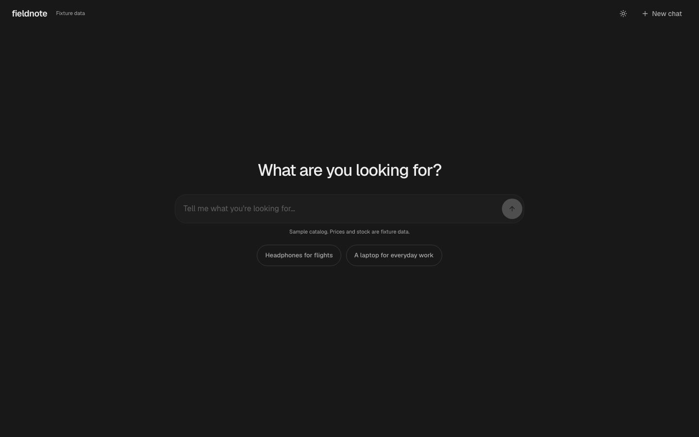
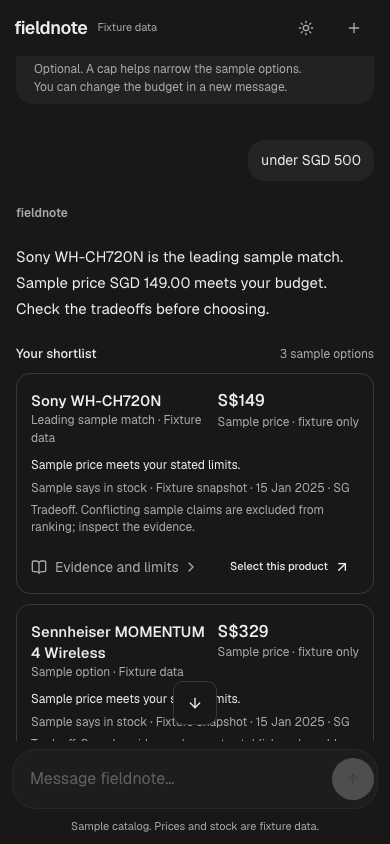
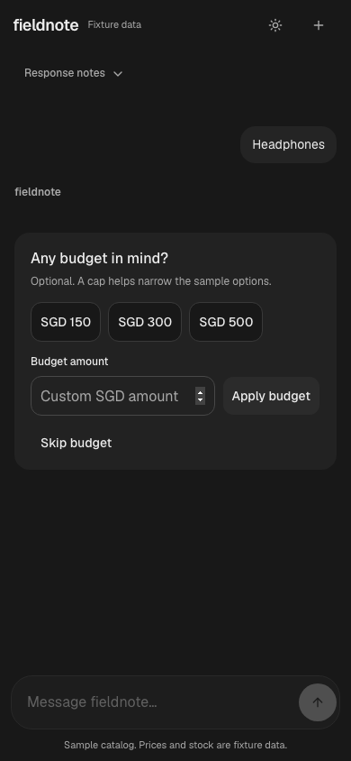
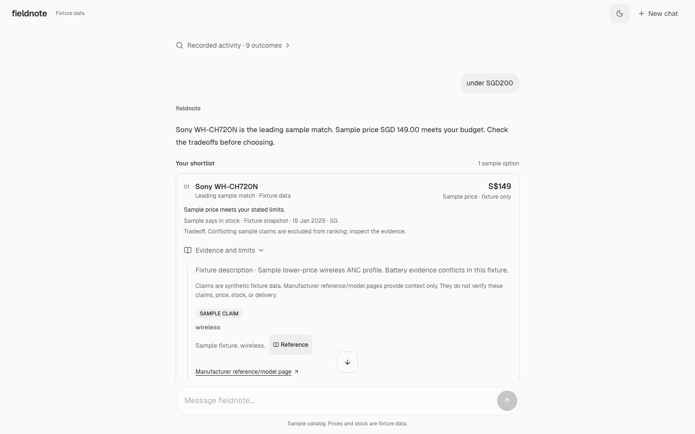

# Review the chat-first design

This redesign replaces the dashboard with a conversation. First visits are dark. Earlier messages remain visible, while current preferences govern new actions. The composer stays at the bottom during conversation. Preference questions and editing controls appear in context.

The actual application screenshots below use the source recorded in [the manifest](application/manifest.json). They are fixture journeys, not live price or stock verification. Desktop images are 1440×900; mobile images are 390×844. The theme uses the official Vite provider pattern and the existing official shadcn/ui and AI Elements components.

The PR stays unmerged until you review these screenshots and confirm the design direction.

## Required states

| State | Desktop | Mobile |
| --- | --- | --- |
| First-visit dark, minimal empty chat | [Open](application/01-empty-dark-desktop.png) | [Open](application/01-empty-dark-mobile.png) |
| Ordinary user and assistant message | [Open](application/02-ordinary-message-desktop.png) | [Open](application/02-ordinary-message-mobile.png) |
| Inline category question | [Open](application/03-category-question-desktop.png) | [Open](application/03-category-question-mobile.png) |
| Optional budget card with Skip | [Open](application/04-budget-question-desktop.png) | [Open](application/04-budget-question-mobile.png) |
| Recommendations in an assistant message | [Open](application/05-shortlist-desktop.png) | [Open](application/05-shortlist-mobile.png) |
| Natural budget follow-up and retained history | [Open](application/06-budget-followup-desktop.png) | [Open](application/06-budget-followup-mobile.png) |
| Expanded evidence | [Open](application/07-evidence-desktop.png) | [Open](application/07-evidence-mobile.png) |
| Light conversation | [Open](application/08-light-conversation-desktop.png) | [Open](application/08-light-conversation-mobile.png) |
| Light preference after refresh | [Open](application/09-light-persisted-desktop.png) | [Open](application/09-light-persisted-mobile.png) |

## Dark first visit

## Mobile conversation

## Contextual preferences

## Light mode

## Mobile evidence correction

Visual inspection caught a narrow evidence disclosure even after functional tests passed. The regression failed at 190px of usable evidence width inside a 358px card. The corrected disclosure is 328px wide, with no document overflow. Independent QA also checked 320px mobile, keyboard citation preview and 44px source/jump targets. [Before](application/evidence-mobile-before.png), [after](application/evidence-mobile-final.png), [geometry](application/evidence-widths-final.json).

The full package suite preserves 29 existing browser journeys and adds 14 chat, responsive and screenshot journeys. The build still reports its existing JavaScript chunk-size warning. Actual device keyboards, live Exa retrieval, current offers and merchant-page reachability are outside this fixture visual review.
