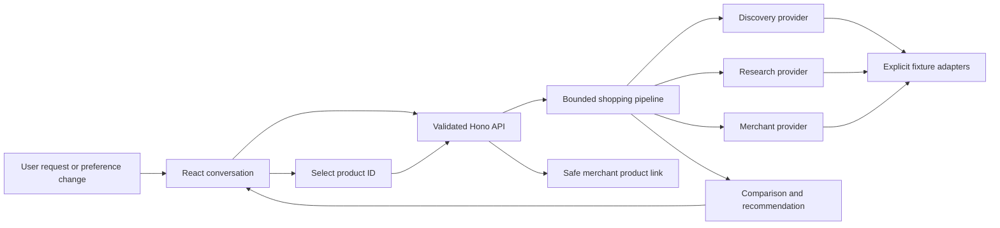

# Application architecture

The first milestone is a local, fixture-backed research-to-merchant assistant. It demonstrates preference understanding, evidence-aware comparison, a recommendation, product selection, and a safe merchant product link. Fixtures establish reproducible behavior. They do not establish current prices, inventory, delivery, or unrestricted language understanding.

## Design decision

Candidate A's functional pipeline is the base. Candidate B contributes discriminated conversation results, preference patches, recovery behavior, and UI states. A separate event/effect framework and free-running manager agent are deferred. They add lifecycle complexity before the bounded request needs it.

An independent Astra judge scored A 20/25 and B 19/25 across evidence honesty, multi-turn completeness, integration replacement, security/failure behavior, and maintainability. The judge agreed with the hybrid. The exposed parent identity did not permit verification of model-family independence. See the [candidate A](architecture-candidate-a.md) and [candidate B](architecture-candidate-b.md) summaries. These design scores are judgments, not runtime measurements.

## Domain

The application models preferences, product identity, research claims, merchant offers, and turn results separately. Hard constraints determine eligibility before flexible priorities influence ranking. Preference patches distinguish changing a value, removing it, and leaving it unchanged.

Claims retain supported, unknown, or conflicting status. Sources carry fixture provenance and fixed observation times. Offers attach price, currency, availability, region, and merchant URL to a product. A research source does not establish merchant inventory. Freshness and truth are separate concerns.

The result union distinguishes ordinary messages, clarification, recommendations, no-match, and failure. Product selection resolves trusted catalog identity through the backend and returns a validated link. It never places an order.

## Boundaries

Runtime schemas validate browser input and provider output. Core ranking and preference logic operate on typed values. Adapters own external data normalization, evidence status, and failure behavior. The API owns media types, payload bounds, origin policy, request IDs, and safe error responses. React renders plain text and validated links.

The engineering agents are separate from the product runtime. Codex agents research, implement, test, and review the repository. The product's first version uses a deterministic planner and fixture adapters, with explicit language/category limits. No model-produced fact is accepted as source evidence.

## State and expansion

The client keeps an ordered turn ledger in useConversation. Each turn retains its submitted message, accepted response snapshot and selection/source state. One controller owns active preferences, valid drafts, request cancellation and current action authority. Earlier messages stay readable; historical offers do not authorize a fresh handoff. Contextual questions collect missing useful preferences without a permanent form. The theme alone persists in localStorage.

The local milestone uses tab-scoped state with a New chat reset. It does not claim authenticated cross-device or restart persistence. PostgreSQL belongs behind authentication and ownership checks when durable multi-user state becomes necessary.

Live providers replace adapters through the same contracts. Each integration needs credentialed runtime evidence before it can be called verified. Live offer checks need currency, region, product variant, price, stock status, retrieval time, expiry, and selection-time refresh. See the [capability matrix](capability-gaps.md) and [security model](security-model.md).
