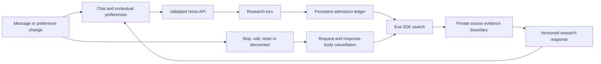

# Application architecture

Fieldnote is a chat-first product research assistant. Normal development requests use Exa to discover real products, collect attributable specifications and retain observed price context. Source pages do not establish current merchant offers, stock, delivery or affordability. Missing configuration, provider failure, empty evidence, cancellation and exhausted limits produce an explicit limitation instead of a synthetic catalog.

## Normal research

The conversation controller sends one bounded research turn through the validated Hono API. The server extracts contextual preferences and separates hard constraints from flexible priorities. Ordinary replies and presentation changes do not dispatch a search. One explicit research operation can reserve one persistent allowance and make one SDK search. Unknown billing retains its reservation and stops new paid work. The shared local ledger is admission policy, not the Exa account balance.

Exa native extraction supplies candidate locators, not factual authority. A private source context owns complete bounded passages, exact model and edition identity, attribution, hard-negative assessment and payment conditions. Those decisions precede positive selection and display packing. A claim is published only with its complete quotation and supporting source window. Gaps, truncation, competing models and unresolved conditions cannot supply missing proof. Packing can drop a fact, but cannot make an excluded product eligible.

## Evidence and merchant boundary

Research responses distinguish model identity, quoted specifications, observed price text, unresolved constraints and safe source links. Prices remain page-observed and unverified. Sale/list/savings text stays complete and is not converted into a scalar current offer. Stock and delivery remain unverified. Identity-only leads explicitly disclose missing specifications. Unsupported categories or unresolved hard constraints produce an honest question or limitation.

The client renders official shadcn/ui and AI Elements. It presents compact leads and responsive comparisons, with full source quotations and citations behind accessible disclosure controls. It renders returned text as text. No source instruction becomes executable behavior. Historical response snapshots stay separate from current preferences and action authority.

`MerchantVerificationProvider` is a separate future interface. It requires exact listing and variant, market, currency, amount, availability semantics, observation and expiry, source reference and destination. No live merchant adapter is enabled. The user confirmed that authorized eBay, Shopify and Best Buy access is unavailable. Issues #2 and #36 remain open until genuine authorized responses satisfy merchant acceptance. Normal research has source links and no payment, purchase or verified merchant-selection action.

## Automated fixture composition

Synthetic products and sample merchant links belong exclusively to explicit automated test composition. The legacy discovery/research/merchant interfaces and fixture renderer remain for reproducible regression tests. Their fixed observations, prices and availability are visibly labeled. They never become a normal provider fallback.

The initial fixture pipeline's design rationale is retained in [candidate A](architecture-candidate-a.md) and [candidate B](architecture-candidate-b.md). Those historical designs are not descriptions of the normal Exa path or proof of live commerce.

## State and security

The client keeps an ordered conversation ledger with submitted messages, accepted response snapshots and current action authority. One controller owns preferences, drafts and cancellation. Earlier messages remain readable, while abandoned operations cannot publish late results. The theme persists locally. Durable authenticated personalization is a separate dependent unit tracked in Issue #3 and PR #41; this branch does not claim its acceptance.

Runtime schemas validate browser input and provider output. Source URLs require safe public HTTPS destinations. The API owns payload bounds, media types, origin policy, request IDs and safe failures. The Exa key remains server-only in the original ignored development environment. Production integration remains disabled. Optional proof diagnostics are development-only, private and bounded; they are absent from normal responses and history.

Engineering agents implement and independently verify the application. They are separate from its deterministic preference and evidence logic. See [Exa setup](exa-research.md), [capability gaps](capability-gaps.md), [security boundaries](security-model.md) and the [engineering workflow](engineering-workflow.md).
